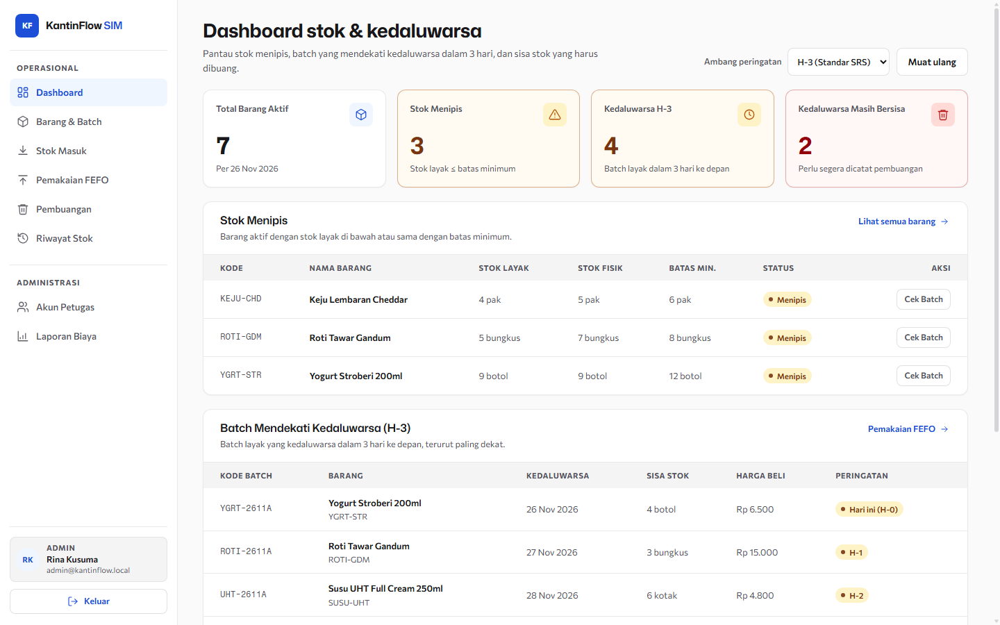
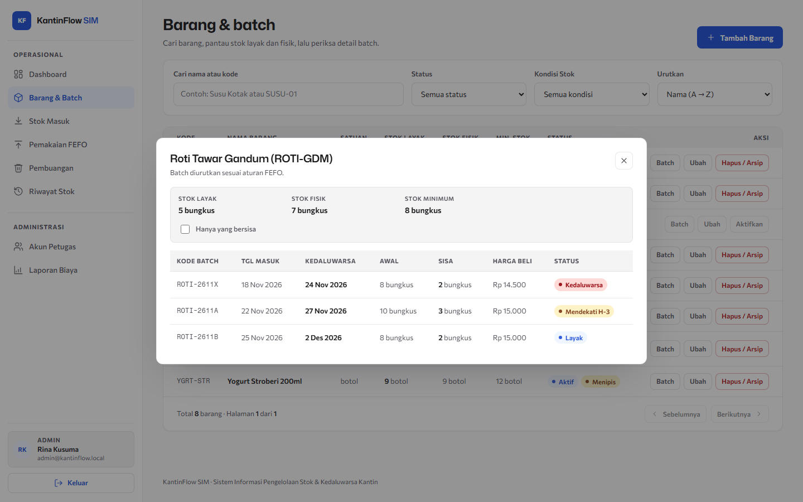
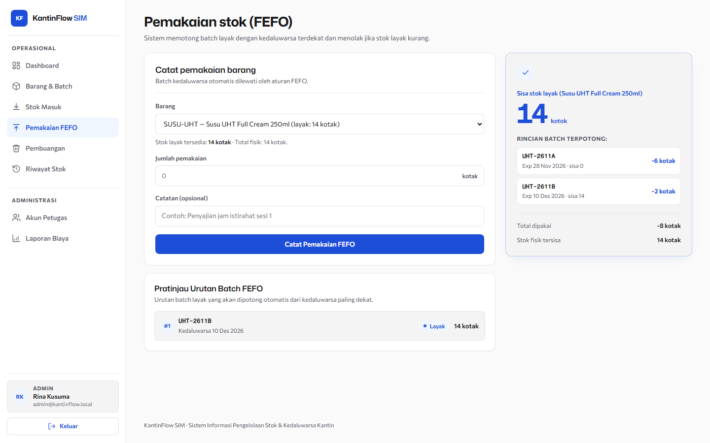
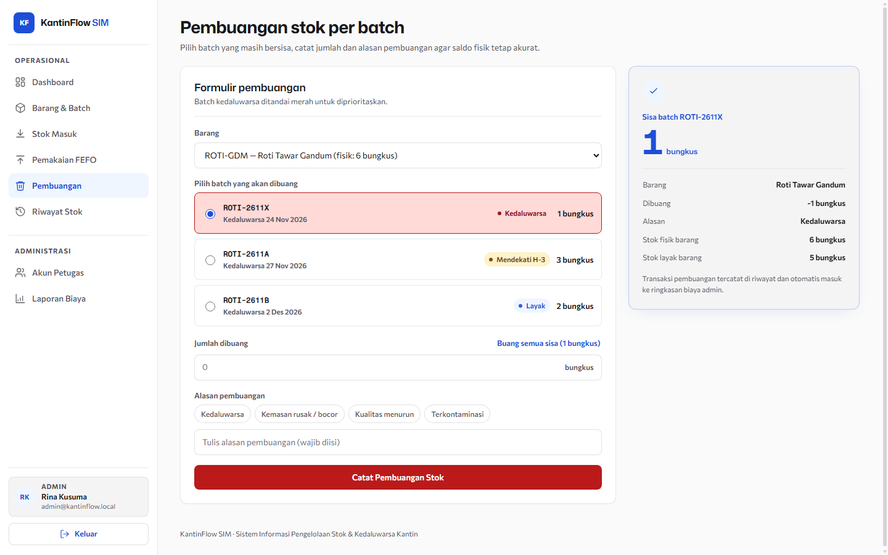
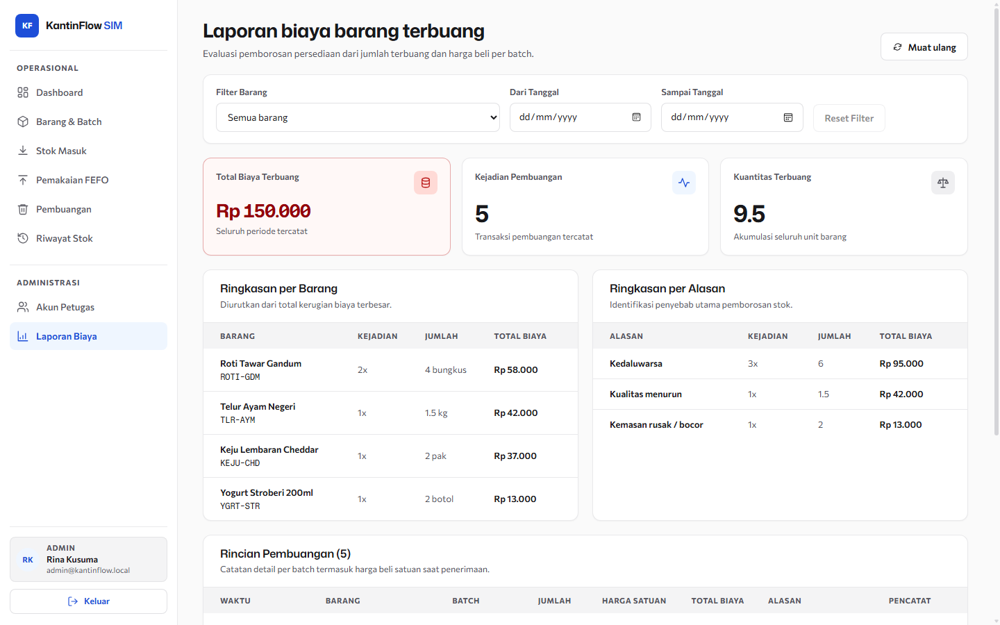
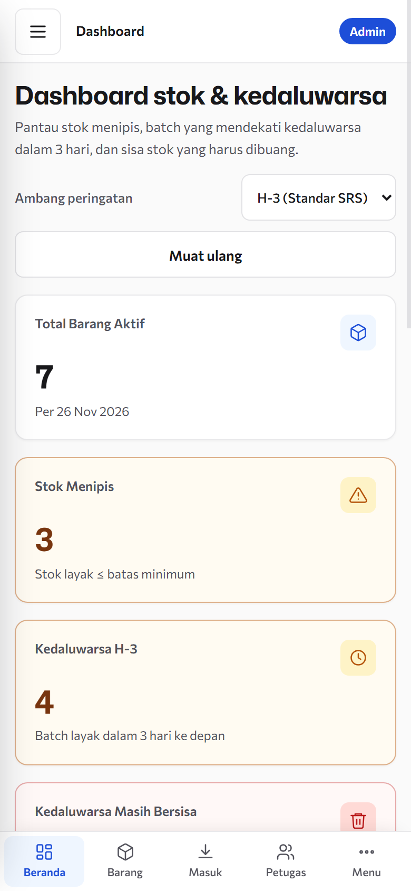
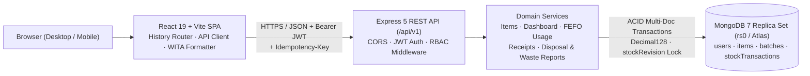

# KantinFlow SIM

**Canteen Inventory & Expiry Management System** — a decoupled full-stack web application for batch-level stock tracking, atomic FEFO (First Expired, First Out) allocation, H-3 expiry alerts, and waste-cost reporting.

[](https://kantinflow-sim.vercel.app/)
[](https://react.dev/)
[](https://vite.dev/)
[](https://expressjs.com/)
[](https://www.mongodb.com/)

---

## Overview

KantinFlow SIM is designed for canteen operations where perishable goods require strict shelf-life control. Instead of tracking only aggregate item quantities, the system tracks inventory per batch with purchase unit cost, receipt date, and expiration date. Stock deductions automatically consume the earliest-expiring usable batches first (FEFO), expired stock is excluded from normal consumption and surfaced for disposal, and administrators receive itemized waste-cost summaries.

Originally built as a coursework project for **Management Information Systems (*Sistem Informasi Manajemen / SIM*)** in the Information Systems Study Program at **Primakara University**, KantinFlow SIM is engineered and deployed as a production-style full-stack web application with multi-document ACID transactions, role-based access control, idempotent write operations, operational timezone consistency (`Asia/Makassar`), and automated unit, integration, security, and benchmark suites.

> **Project Scope Note:** **KantinFlow SIM** is a full-stack web application (React + Vite frontend, Node.js + Express REST API, MongoDB replica set). It is separate from the **KantinFlow PBO** desktop implementation and has its own architecture, API contract, and codebase.

**Live Application:** [https://kantinflow-sim.vercel.app/](https://kantinflow-sim.vercel.app/) *(requires an authenticated account; see [Installation and Local Development](#installation-and-local-development) to run a local instance with demo accounts)*



---

## Key Features

- **JWT Authentication & Role-Based Access Control (RBAC)**
  - Password hashing with `bcryptjs` (10 rounds), HS256 JWT bearer tokens, uniform `401 INVALID_CREDENTIALS` responses to prevent account enumeration, and per-request database checks ensuring deactivated users cannot reuse existing tokens.
  - Clear separation between **`admin`** (catalog CRUD, staff account management, cost visibility, waste-cost reports) and **`petugas`** (operational stock monitoring, receipts, FEFO usage, disposals, and cost-redacted transaction history).
  - Self-deactivation guard (`409 CANNOT_DEACTIVATE_SELF`) and automatic client-side session clearing on `401` responses.

- **Batch-Based Inventory Management & Safe Archival**
  - Item catalog with search by code or name, status filtering (`active`, `archived`, `all`), low-stock filtering, multi-column sorting, pagination, and configurable decimal precision (`quantityScale` 0–4) backed by MongoDB `Decimal128` and `BigInt` decimal arithmetic.
  - Safe deletion lifecycle: items without history are permanently deleted (`204`); items with history and zero physical stock are archived (`isActive: false`, `200 ARCHIVED`); items with remaining physical stock are protected (`409 ITEM_HAS_STOCK`).

- **Atomic FEFO (First Expired, First Out) Allocation**
  - Stock usage (`POST /api/v1/stock/usages`) selects only usable batches (`remainingQuantity > 0` and `expiresOn >= today`) ordered by `expiresOn`, `receivedOn`, and `_id`, allocating across multiple batches automatically while skipping expired stock.
  - Executes inside a MongoDB multi-document transaction (`session.withTransaction`) with per-item `stockRevision` locking; requests exceeding usable stock fail cleanly (`409 INSUFFICIENT_USABLE_STOCK`) with zero partial deductions.

- **Expiry Monitoring (H-3) & Minimum Stock Alerts**
  - Operational dashboard (`GET /api/v1/dashboard`) summarizes active items, low-stock items (`usableStock <= minimumStock`), batches approaching expiry (configurable `H-3`, `H-7`, or `H-14` threshold, defaulting to `H-3`), and expired batches with remaining physical stock awaiting disposal.

- **Idempotent Stock Receipts & Chronological Audit Trail**
  - Stock-in (`POST /api/v1/stock/receipts`) requires an `Idempotency-Key` header hashed alongside a canonical SHA-256 request payload: identical retries replay the original response (`200`), while conflicting payloads for the same key are rejected (`409 IDEMPOTENCY_CONFLICT`).
  - Chronological transaction log (`GET /api/v1/transactions`) with item, movement type (`RECEIPT`, `USAGE`, `DISPOSAL`), and operational date-range filters; purchase and total cost fields are omitted for `petugas`.

- **Disposal Workflow & Admin Waste-Cost Reporting**
  - Per-batch disposal (`POST /api/v1/stock/disposals`) prioritizes expired batches, enforces a required disposal reason, rejects archived items (`409 ITEM_INACTIVE`), and prevents over-disposal (`409 INSUFFICIENT_BATCH_STOCK`).
  - Admin-only disposal report (`GET /api/v1/reports/disposals`; `403 FORBIDDEN` for `petugas`) calculates total waste quantity and cost in IDR using exact decimal snapshots, grouped by item, by reason, and by individual event.

- **Operational Timezone Consistency (`Asia/Makassar` / WITA, UTC+08:00)**
  - Operational dates (`today` for H-0/H-3 classification and FEFO eligibility), date-range query boundaries (`from`/`to`), form defaults, and formatted transaction timestamps are explicitly evaluated in `Asia/Makassar`, independent of server or browser host timezone settings.

- **Responsive Multi-Device Interface**
  - Single-stylesheet design system built with CSS Custom Properties (zero CSS framework runtime overhead), providing a desktop sidebar shell, tablet/mobile slide-over navigation drawer, and mobile bottom navigation bar.

---

## Visual Tour

### Inventory Catalog & FEFO Batch Details

Inspect usable vs. physical stock per item and open the FEFO-ordered batch modal showing `Kedaluwarsa` (expired), `Mendekati H-3` (expiring soon), `Layak` (usable), and `Habis` (depleted) statuses alongside unit purchase costs for admins.



### Atomic FEFO Stock Allocation

Preview the exact batch consumption order before submitting. After confirmation, the summary panel breaks down every batch deducted across expiry dates and updates usable stock in real time.



### Batch Disposal Workflow

Expired batches are highlighted for priority removal with quick reason presets, remaining-quantity shortcuts, and atomic physical balance updates.



### Admin Waste-Cost Report

Administrators can filter disposal costs by item and WITA date range to evaluate total financial loss, top wasted items, and primary waste reasons.



### Responsive Mobile Layout

Operational monitoring and navigation adapt to small viewports with stacked KPI cards, top header role indicators, and a bottom navigation bar.

<p align="center">
  
</p>

---

## Technology Stack

| Layer | Technologies | Notes |
| --- | --- | --- |
| **Frontend** | React 19, Vite 8, CSS Custom Properties | Custom History API SPA router (`frontend/src/App.jsx`), role-gated navigation, `fetch` API client, idempotency helper, Indonesian UI copy. |
| **Backend** | Node.js 22.12+, Express 5 | Modular `/api/v1` REST API (`routes/`, `services/`, `middleware/`, `lib/`), 16 KB JSON body limit, multi-origin CORS allowlist, centralized error handling. |
| **Database** | MongoDB 7 (Replica Set `rs0` / Atlas) | Collections: `users`, `items`, `batches`, `stockTransactions`; multi-document transactions (`session.withTransaction`), `Decimal128`, unique & composite indexes. |
| **Security** | `jsonwebtoken` (HS256), `bcryptjs` (10 rounds) | Bearer token authentication, server-side RBAC enforcement, active-account verification, role-based cost field redaction. |
| **Testing** | Node Test Runner (`node:test`), Supertest | Unit tests, HTTP integration tests against isolated ephemeral databases, RBAC security matrix, WITA timezone tests, and API load benchmark. |
| **Deployment** | Vercel (Frontend SPA & Serverless API), MongoDB Atlas | Supports both Vercel Serverless (`backend/api/index.mjs`) and standard Node.js HTTP hosting (`backend/server.mjs`). |

---

## Technical Architecture



### Key Engineering Decisions

- **Atomic Concurrency Control:** Stock mutations (`receipts`, `usages`, `disposals`) and item status/deletion updates increment `items.stockRevision` inside a MongoDB replica-set transaction, serializing concurrent writes against the same item and eliminating lost updates or negative batch balances.
- **Exact Decimal Math:** Quantities and currency amounts are stored as MongoDB `Decimal128` and computed with arbitrary-precision `BigInt` helpers (`backend/lib/decimal.mjs`) rather than IEEE-754 floating-point numbers.
- **Idempotency Replay Safety:** Client write screens generate payload-fingerprinted `Idempotency-Key` values (`frontend/src/idempotency.js`) matched against a unique `{ actorId, idempotencyKey }` index in `stockTransactions`, preventing duplicate writes during network retries.
- **Dual Backend Entry Points:** `backend/app.mjs` exports a stateless Express app factory consumed by both `backend/server.mjs` (long-running Node.js HTTP server) and `backend/api/index.mjs` (Vercel Serverless handler with cached MongoDB connection initialization).

### API Surface (`/api/v1`)

| Endpoint | Access | Purpose |
| --- | --- | --- |
| `GET /api/v1/health` | Public | Service health check (`{ "status": "ok" }`) |
| `POST /api/v1/auth/login` | Public | Bcrypt verification & HS256 JWT issuance |
| `GET / POST /api/v1/users`, `PATCH /api/v1/users/:id` | `admin` | Staff/admin account listing, creation, activation toggle |
| `GET /api/v1/items`, `/:id`, `/:id/batches` | `admin`, `petugas` | Paginated item catalog & FEFO-sorted batch details |
| `POST / PATCH / DELETE /api/v1/items` | `admin` | Item CRUD and safe permanent-delete / archive lifecycle |
| `POST /api/v1/stock/receipts` | `admin`, `petugas` | Idempotent atomic stock-in creating batch + transaction |
| `POST /api/v1/stock/usages` | `admin`, `petugas` | Atomic cross-batch FEFO stock consumption |
| `POST /api/v1/stock/disposals` | `admin`, `petugas` | Atomic per-batch stock disposal with required reason |
| `GET /api/v1/dashboard` | `admin`, `petugas` | KPI summary, low stock, H-3/H-7/H-14 near-expiry, expired stock |
| `GET /api/v1/transactions` | `admin`, `petugas` | Filtered, paginated stock audit trail (cost fields admin-only) |
| `GET /api/v1/reports/disposals` | `admin` | Waste quantity & cost aggregation by item, reason, and event |

Full request/response contracts and a 19-request Postman v2.1 collection are available in [`backend/README.md`](backend/README.md) and [`docs/kantinflow.postman_collection.json`](docs/kantinflow.postman_collection.json).

---

## Installation and Local Development

### Prerequisites

- **Node.js 22.12+** (uses native `--env-file-if-exists` and `node:test`; verified on Node.js v26.13.1).
- **MongoDB 7+ Replica Set** (required for multi-document ACID transactions).
  - On **Windows (PowerShell)**, the repository includes portable MongoDB 7.0.14 helper scripts (`npm run db:start` / `npm run db:stop`) that download and run a local single-node replica set (`rs0`) inside `backend/.tools/` and `backend/.data/` (both git-ignored; ~1–2 GB disk space).
  - On **macOS / Linux**, run a local MongoDB replica set (`rs0`) or point `MONGODB_URI` to a dedicated development MongoDB Atlas database.
- *PowerShell note:* Use `npm.cmd` if your PowerShell execution policy restricts `npm.ps1`.

### 1. Clone & Configure Environment Files

```powershell
git clone https://github.com/Skiidig/kantinflow-sim.git
cd kantinflow-sim

Copy-Item backend\.env.example backend\.env
Copy-Item frontend\.env.example frontend\.env
```

Edit `backend/.env` and set a random `JWT_SECRET` (minimum 32 bytes) along with local passwords for `DEMO_ADMIN_PASSWORD` and `DEMO_PETUGAS_PASSWORD`. Leave `VITE_API_BASE_URL` empty in `frontend/.env` for local development so Vite proxies `/api` to `http://127.0.0.1:3000`.

### 2. Install Dependencies & Seed Local Demo Data

```powershell
npm.cmd --prefix backend install
npm.cmd --prefix frontend install

# Start local MongoDB replica set (Windows helper) and seed demo accounts + sample item
npm.cmd run db:start
npm.cmd run seed
```

Demo accounts created in the local development database (`kantinflow_dev`) using passwords from `backend/.env`:
- **Admin:** `admin@kantinflow.local`
- **Staff (*Petugas*):** `petugas@kantinflow.local`

### 3. Run the Full Stack

From the repository root:

```powershell
npm.cmd start
```

`scripts/dev.mjs` launches MongoDB (`rs0`), the Express backend (`http://127.0.0.1:3000/api/v1`), and the Vite frontend (`http://localhost:5173`) in one terminal. Press `Ctrl+C` to stop all three services cleanly.

*(Manual alternative: run `npm.cmd --prefix backend run db:start`, `npm.cmd --prefix backend start`, and `npm.cmd --prefix frontend run dev` in separate terminals, then `npm.cmd run db:stop` when finished.)*

---

## Environment Configuration

Never commit `.env` files (ignored by `.gitignore`). Use safe placeholders when sharing configuration examples.

### Backend (`backend/.env.example`)

| Variable | Example / Default | Description |
| --- | --- | --- |
| `PORT` | `3000` | Local HTTP server port (matches Vite dev proxy and Postman collection) |
| `MONGODB_URI` | `mongodb://127.0.0.1:27017/kantinflow_dev?replicaSet=rs0` | MongoDB replica set connection URI (local `rs0` or Atlas `mongodb+srv://...`) |
| `MONGODB_DB` | `kantinflow_dev` | Target MongoDB database name |
| `JWT_SECRET` | `<random-32-byte-secret>` | HS256 signing secret (enforced minimum 32 bytes on startup) |
| `JWT_EXPIRES_IN` | `8h` | Access token expiration duration |
| `CORS_ORIGIN` | `http://localhost:5173` | Comma-separated allowlist of permitted frontend origins |
| `TEST_MONGODB_URI` | `mongodb://127.0.0.1:27017/?replicaSet=rs0` | Replica set URI for automated integration tests (uses ephemeral `kantinflow_test_<hex>` DBs) |
| `DEMO_ADMIN_EMAIL` / `_PASSWORD` / `_NAME` | `admin@kantinflow.local` / `<local-password>` / `Admin Kantin` | Local seed admin account |
| `DEMO_PETUGAS_EMAIL` / `_PASSWORD` / `_NAME` | `petugas@kantinflow.local` / `<local-password>` / `Petugas Demo` | Local seed staff account |

### Frontend (`frontend/.env.example`)

| Variable | Example / Default | Description |
| --- | --- | --- |
| `VITE_API_BASE_URL` | *(empty locally)* | Empty locally to use the Vite `/api` proxy; set to the deployed backend origin (without trailing slash) in production |

---

## Testing, Quality Checks & Benchmark

### Running Checks

```powershell
# Backend unit & Supertest integration tests (requires active MongoDB replica set)
npm.cmd run db:start
npm.cmd run test:backend
npm.cmd run benchmark
npm.cmd run db:stop

# Frontend unit tests & production build
npm.cmd run test:frontend
npm.cmd run build:frontend
```

### Verified Results

- **Backend Automated Tests (`node:test` + Supertest):** **21/21 passed** (0 failed, 0 skipped) covering authentication, `bcryptjs` hashing, user management, item CRUD/archival, batch FEFO ordering, atomic receipts & idempotency replay/rollback, cross-batch FEFO usage, batch disposals, archived-item disposal guards (`409 ITEM_INACTIVE`), admin waste-cost reporting, CORS & health checks, cross-timezone `Asia/Makassar` consistency, an end-to-end HTTP workflow, and a full **Security Matrix** (`401` on all 15 protected endpoints; `403` on all 7 admin-only endpoints).
- **Frontend Unit Tests & Production Build:** **8/8 passed** (IDR currency formatting, calendar date preservation, WITA timestamp & operational date consistency across host timezones, date-range validation, role/status label helpers, and idempotency key resolution) and `vite build` succeeds cleanly.
- **Local API Benchmark (`backend/scripts/benchmark.mjs`):** Executed against an ephemeral `kantinflow_bench_<hex>` database seeded with **100 items, 300 batches, and 200 transactions** at **100 requests/endpoint** with **concurrency 10** (target `< 500 ms`):

| Endpoint | Min | Avg | P50 | P95 | Max | Target (`< 500 ms`) |
| --- | ---: | ---: | ---: | ---: | ---: | :---: |
| `GET /api/v1/items?page=1&limit=20&sortBy=name&sortOrder=asc` | 22.96 ms | 33.34 ms | 31.56 ms | 48.40 ms | 55.54 ms | Pass |
| `GET /api/v1/items?q=BRG-05&lowStock=true` | 8.39 ms | 14.72 ms | 14.83 ms | 17.66 ms | 19.00 ms | Pass |
| `GET /api/v1/dashboard` | 22.56 ms | 76.78 ms | 68.00 ms | 138.95 ms | 177.26 ms | Pass |

*(Benchmark figures reflect local single-node MongoDB replica set execution and will vary by host hardware and network latency.)*

---

## Deployment

- **Frontend (Vercel SPA):** Deployed from `frontend/` using `vite build` with `frontend/vercel.json` rewriting all client routes to `/index.html`. Configure `VITE_API_BASE_URL` to the production backend origin.
- **Backend (Vercel Serverless or Node.js HTTP Host):**
  - *Vercel Serverless:* `backend/vercel.json` routes requests to `backend/api/index.mjs`, which initializes a pooled MongoDB client (`maxPoolSize: 5`) and reuses the Express 5 app across warm invocations.
  - *Standard Node.js Host (e.g., Render / VPS):* Run `npm start` inside `backend/` (`backend/server.mjs`) with `GET /api/v1/health` as the readiness probe.
- **Database:** MongoDB Atlas (replica set enabled by default for multi-document transactions). Configure `CORS_ORIGIN` to include the production frontend URL (`https://kantinflow-sim.vercel.app`).

---

## Known Limitations

- **Windows-Specific Portable MongoDB Helper:** `npm run db:start` and `npm run db:stop` use Windows PowerShell scripts to download and manage a local MongoDB 7.0.14 replica set. Developers on macOS or Linux must provide their own MongoDB replica set URI in `backend/.env`.
- **Session Lifecycle:** Access tokens are stored in browser `sessionStorage` with an `8h` default TTL and no refresh-token rotation or server-side token revocation list beyond active-user status checks.
- **Operational Scope:** Self-service password resets, user password updates via UI, automated scheduled notifications (email/push), and CSV/PDF report exports are not implemented.
- **UI Language:** The application interface and validation messages are written in Indonesian to match the canteen operational context and academic specification.

---

## Additional Documentation

- **Backend Technical Reference:** [`backend/README.md`](backend/README.md)
- **Frontend Technical Reference:** [`frontend/README.md`](frontend/README.md)
- **End-to-End Demo Walkthrough:** [`docs/DEMO_GUIDE.md`](docs/DEMO_GUIDE.md)
- **Postman Collection v2.1 (19 Requests):** [`docs/kantinflow.postman_collection.json`](docs/kantinflow.postman_collection.json)

---

## Credits & Third-Party Attribution

- **Core Libraries:** [React](https://react.dev/) (MIT), [Vite](https://vite.dev/) (MIT), [Express](https://expressjs.com/) (MIT), [MongoDB Node.js Driver](https://www.mongodb.com/docs/drivers/node/current/) (Apache-2.0), [jsonwebtoken](https://github.com/auth0/node-jsonwebtoken) (MIT), [bcryptjs](https://github.com/dcodeIO/bcrypt.js) (BSD-3-Clause), and [Supertest](https://github.com/ladjs/supertest) (MIT).
- **Typography & Icons:** Web fonts loaded from [Google Fonts](https://fonts.google.com/) (**Commissioner**, **Mona Sans**, and **Fragment Mono**, distributed under the SIL Open Font License 1.1). UI icons are custom inline SVGs defined in [`frontend/src/components/Icon.jsx`](frontend/src/components/Icon.jsx).
- **Academic Context:** Developed for the Management Information Systems (*Sistem Informasi Manajemen*) course, Information Systems Study Program, Primakara University.

---

## License

This repository is publicly visible for educational and portfolio review. **No open-source license file is currently included**; all rights remain reserved by the repository author unless a license is explicitly added.
